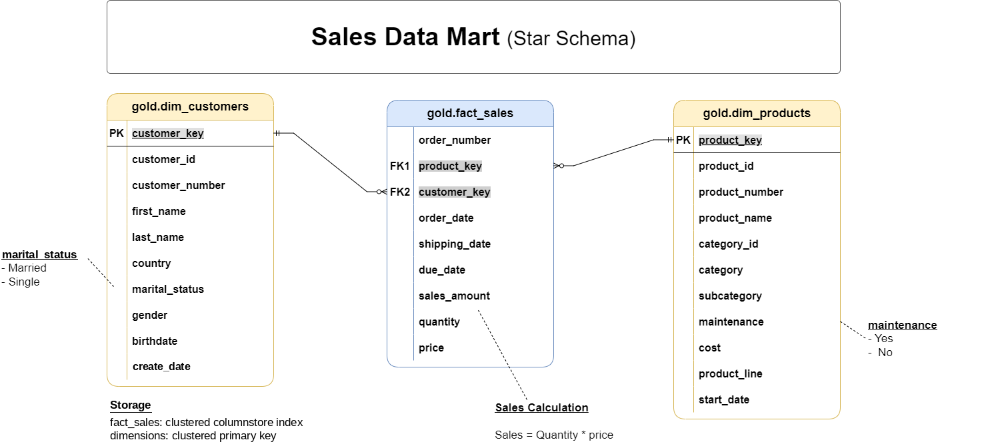

# Data Warehouse and Analytics System

A SQL Server data warehouse that combines **116K+ records** from two source systems (CRM and ERP) into a **star schema**, loads only new and changed data, and makes analytical queries **up to 98x faster** with columnstore storage.

| 116,292 | 98x | 156,483 → 380 | 0 rows | 10 / 10 |
|:--:|:--:|:--:|:--:|:--:|
| source records integrated | fastest query speed-up | pages read by the customer report | processed when nothing changed | automated tests passed |

---

## Problem Statement

- Sales data is split across two systems: the **CRM** (customers, products, sales) and the **ERP** (birthdates, countries, categories). Their keys do not match.
- The raw data has duplicates, extra spaces, codes instead of names, invalid dates and wrong sales amounts.
- Reloading everything on every run wastes time and loses the history of changes.
- Reports built on views recalculate every join on every run, so they are slow.

---

## Key Features

| Feature | What it does |
|:--|:--|
| **Medallion architecture** | Bronze (raw) → Silver (clean) → Gold (business-ready), built with SQL stored procedures |
| **Star schema data model** | One fact table (`fact_sales`) and two dimensions (`dim_customers`, `dim_products`) |
| **Incremental loading** | A **watermark** per table remembers where the last load stopped; only newer rows are read |
| **Change detection** | A **SHA2_256 hash** of each row shows in one comparison whether anything changed |
| **SCD Type 1 and Type 2** | Changed customers are overwritten (Type 1); changed products get a new version and keep their history (Type 2) |
| **Query performance** | Gold stored as tables, with a **clustered columnstore index** on the fact table |
| **Audit logging and error handling** | Every table load is logged (status, rows, time, error); a failed load is rolled back and the watermark does not move |
| **Analytics and reports** | 13 SQL scripts: exploration, trends, rankings, segmentation, plus customer and product report views |

---

## Architecture


### Data Flow


---

## Data Model

A **star schema** in the Gold layer: `fact_sales` holds one row per order line and links to `dim_customers` and `dim_products` through surrogate keys.



---

## Results

### Query performance

Gold built as views compared with Gold built as tables plus a clustered columnstore index. Measured on SQL Server 2022 with the project data; median of 10 runs.

| Query | Pages read (before → after) | Time (before → after) | Speed-up |
|:--|--:|--:|--:|
| Customer report | 156,483 → 380 | 638 ms → 164 ms | **3.9x** |
| Product report | 168,535 → 109 | 619 ms → 35 ms | **17.9x** |
| Revenue by category | 1,774 → 17 | 79 ms → 3 ms | **26.3x** |
| Orders of one customer | 1,759 → 107 | 99 ms → 1 ms | **98.5x** |

**How:** with views, every query rebuilt the keys and joins and used temporary worktables (spools). Storing Gold as tables does that work once per load, and the columnstore index lets queries read compressed columns in fast batch mode. The customer report plan went from **30+ steps to 7** (execution plans in `04_docs/execution_plans/`).

Also tested and not used, because they gave no gain: extra indexes on Silver, rowstore indexes on the fact table, and partitioning by year.

### Data loading

| Check | Result |
|:--|:--|
| First load | 18,484 customers, 295 products (397 versions with history), 60,398 sales |
| Second load with no new data | 0 rows inserted or updated |
| Gold tables compared with the original view-based model | identical data |

---

## Tech Stack

**SQL Server 2022** · **T-SQL** (stored procedures, window functions, `HASHBYTES`, columnstore indexes) · **SSMS** · CSV source files

---

## Getting Started

1. Install SQL Server 2022 (Express or Developer) and SSMS.
2. Copy the project to `C:\sql\dwh_project\`, so the CSV files are in `C:\sql\dwh_project\01_datasets\`.
3. In SSMS, run the scripts in this order:

```
02_scripts/01_setup/     01_init_database.sql   02_ddl_audit.sql
02_scripts/02_bronze/    ddl_bronze.sql         proc_load_bronze.sql
02_scripts/03_silver/    ddl_silver.sql         proc_load_silver.sql
02_scripts/04_gold/      ddl_gold.sql           proc_load_gold.sql
02_scripts/05_etl/       proc_load_all.sql
```

4. Load the warehouse (run this again whenever new data arrives):

```sql
EXEC dbo.load_all;
```

5. Run the analytics scripts in `02_scripts/06_analytics/` (01 to 13).

---

## Testing

All test scripts are in `03_tests/`. Run them after `EXEC dbo.load_all;`.

| Script | What it checks |
|:--|:--|
| `01_quality_checks_silver.sql` | Duplicates, missing keys, extra spaces, invalid values and dates in Silver |
| `02_quality_checks_gold.sql` | Unique keys and links between the fact table and the dimensions |
| `03_test_incremental_scd.sql` | 10 PASS / FAIL tests: incremental load, hash check, SCD Type 1 and 2, watermarks, error logging |
| `04_performance_benchmark.sql` | Pages read and time of the main Gold queries |

---

## Project Structure

```
├── 01_datasets/          CRM and ERP source files (CSV)
├── 02_scripts/
│   ├── 01_setup/         database, schemas, ETL log and watermark tables
│   ├── 02_bronze/        raw tables and full load
│   ├── 03_silver/        clean tables and incremental load (watermark, hash, SCD)
│   ├── 04_gold/          star schema tables and load (columnstore)
│   ├── 05_etl/           one procedure that runs the whole ETL
│   └── 06_analytics/     13 analysis and report scripts
├── 03_tests/             quality checks, incremental/SCD tests, performance benchmark
└── 04_docs/              diagrams and execution plans
```

---

## Acknowledgement

The base Bronze, Silver and Gold pipeline, the original diagrams and the analytics scripts started from the SQL Data Warehouse course project by Baraa Khatib Salkini (MIT License).
