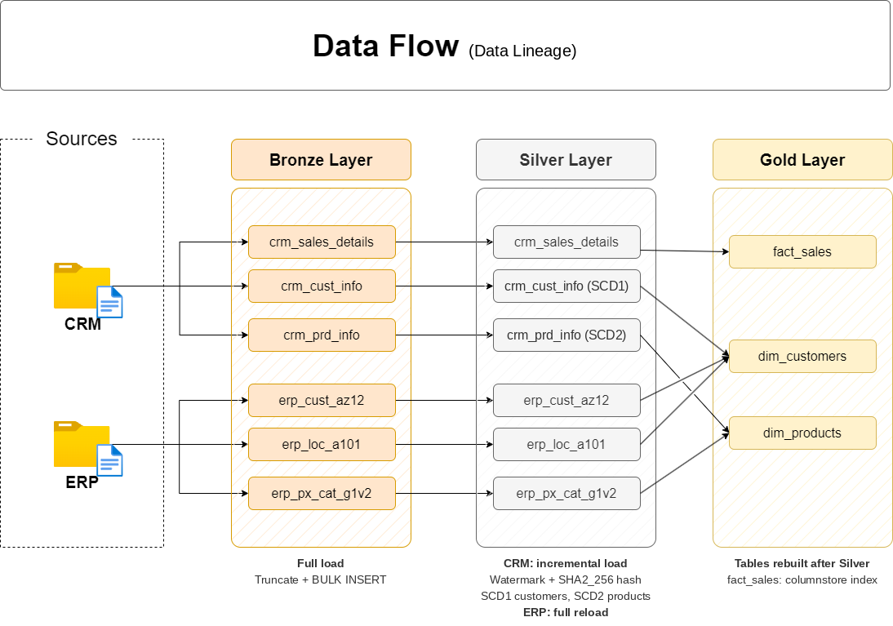

# Data Warehouse and Analytics System

An end-to-end **SQL Server Data Warehouse** project that integrates data from multiple CRM and ERP source systems, processes it using **Medallion Architecture**, and prepares it for analytical reporting.

## Key Highlights

- **116,292 Records** integrated from 6 CRM and ERP source systems.
- **98.5× Maximum Query Speed-up** through performance optimization.
- **156,483 → 380 Page Reads** for the customer report.
- **0 Unchanged CRM Rows** inserted or updated when rerunning with unchanged source data.
- **10/10 Tests Passed** for incremental loading and SCD validation.

## Problem Statement

- **Scattered Data:** Information distributed across multiple CRM and ERP systems.
- **Poor Data Quality:** Duplicates, missing values, inconsistent formats, and invalid records.
- **Data Changes:** Need to identify new and modified records without reloading all CRM data.
- **Historical Tracking:** Need to maintain changes in customer and product information.
- **Reporting Requirements:** Need for clean, structured data for business analysis.

## Technologies Used

- **Database:** SQL Server 2022
- **Query Language:** T-SQL
- **Tools:** SQL Server Management Studio (SSMS)
- **Data Sources:** CRM and ERP CSV files
- **ETL:** Stored Procedures, BULK INSERT, Incremental Loading
- **Data Processing:** SHA2_256 Hashing, Watermarks, Window Functions
- **Data Modeling:** Star Schema, SCD Type 1 and Type 2
- **Performance Optimization:** Clustered Columnstore Index, Customer-Number Index

## Architecture

The project follows the **Medallion Architecture**, with data passing through Bronze, Silver, and Gold layers.


### Data Flow



## Data Processing

### 1. Bronze Layer

Stores raw data from the 6 CRM and ERP CSV source files.

- Loads source files using **BULK INSERT**.
- Performs full loading without applying transformations.
- Preserves the original source data.

### 2. Silver Layer

Cleans, standardizes, validates, and prepares data from the Bronze layer.

**Data Cleaning and Standardization**

| Transformation | Example |
|---|---|
| Gender code standardization | `m` → `Male`, `f` → `Female` |
| Marital status standardization | `S` → `Single`, `M` → `Married` |
| Product line standardization | `M` → `Mountain`, `R` → `Road` |
| Country standardization | `US` → `United States`, `DE` → `Germany` |
| Duplicate removal | Retain the latest customer record |
| Invalid date handling | Invalid dates → `NULL` |
| Sales validation | Recalculate incorrect sales using `quantity × price` |
| Missing value handling | Missing or invalid values → `NULL` or `n/a`, where applicable |

**Incremental Loading and Change Detection**

- **Watermarks:** Identify new and modified CRM records and track loading progress.
- **SHA2_256 Hashing:** Generate fingerprints to detect changes in customer and product records.
- **ROW_NUMBER():** Identify duplicate customer records and retain the latest record.
- **LAG():** Compare product hashes with previous product versions to identify changes.
- **LEAD():** Determine product version end dates and identify the current version.

**Historical Data Management**

- **SCD Type 1 – Customers:** Overwrite existing customer information when changes occur.
- **SCD Type 2 – Products:** Preserve historical product versions by closing old records and inserting new versions.
- **ERP Lookup Tables:** Fully reloaded during each ETL execution.

### 3. Gold Layer

Transforms the cleaned Silver data into a **Star Schema** for analytical queries and reporting.

**Star Schema Implementation**

- **Fact Table – `gold.fact_sales`:** Stores sales transactions, with one row per order line.
- **Dimension Table – `gold.dim_customers`:** Stores customer information.
- **Dimension Table – `gold.dim_products`:** Stores product information.
- **Surrogate Keys:** Generated using `ROW_NUMBER()` for customer and product dimensions.
- **Table Loading Order:** Loads customer and product dimensions first, followed by the sales fact table.

**Indexes Used**

- **Clustered Columnstore Index (CCI):** Applied to the fact table to improve analytical query performance.
- **Customer-Number Index:** Supports faster individual customer lookups.

**Transactional Loading**

- Rebuilds the Gold dimensions and fact table after Silver loading.
- Uses a single **transaction** for the complete Gold rebuild.
- Uses **COMMIT** when the complete load succeeds and **ROLLBACK** if an operation fails, preserving the previous Gold data.

## Data Model

A **star schema** in the Gold layer: `fact_sales` holds one row per order line and links to `dim_customers` and `dim_products` through surrogate keys.


## Data Analytics

Created 11 SQL analytics reports:

1. Database Exploration
2. Dimension Exploration
3. Date Exploration
4. Measures Exploration
5. Magnitude Analysis
6. Ranking Analysis
7. Change-over-Time Analysis
8. Cumulative Analysis
9. Performance Analysis
10. Part-to-Whole Analysis
11. Data Segmentation

## ETL Auditing and Error Handling

| Feature | Implementation |
|---|---|
| **Audit Logging** | Tracks batch IDs, execution times, processed rows, status, and error details. |
| **Watermark Tracking** | Maintains incremental loading progress. |
| **Error Handling** | Uses `TRY...CATCH` and `THROW` to capture and report failures. |
| **Transaction Management** | Uses `BEGIN TRANSACTION`, `COMMIT`, and `ROLLBACK`. |
| **Pipeline Orchestration** | `dbo.load_all` coordinates the Bronze → Silver → Gold loading process. |

## Performance Optimization

Compared the earlier **view-based implementation** with physical Gold tables using SQL Server 2022. Results represent the **median of 10 query executions**.

| Analytical Query | Pages Read (Before → After) | Time (Before → After) | Speed-up |
|---|---:|---:|---:|
| Customer Report | 156,483 → 380 | 638 ms → 164 ms | **3.9×** |
| Product Report | 168,535 → 109 | 619 ms → 35 ms | **17.9×** |
| Revenue by Category | 1,774 → 17 | 79 ms → 3 ms | **26.3×** |
| Monthly Sales Trend | 1,471 → 39 | 106 ms → 13 ms | **8.1×** |
| Top 10 Customers | 2,044 → 300 | 177 ms → 20 ms | **8.9×** |
| Orders of One Customer | 1,759 → 107 | 99 ms → 1 ms | **98.5×** |
| Sales by Category for One Quarter | 3,558 → 89 | 81 ms → 7 ms | **12.4×** |

**Key Optimization Techniques**

- Replaced the earlier view-based implementation with physical Gold tables.
- Used **Clustered Columnstore Indexing** and batch processing for analytical queries.
- Used the **Customer-Number Index** for faster individual customer lookups.
- Reduced unnecessary data reads through columnstore processing.

## How to Run

**Prerequisites:** SQL Server 2022, SSMS, and access to the CSV datasets.

1. Clone the repository and open the SQL scripts in SSMS.
2. Update the CSV paths in the Bronze loading procedure and provide SQL Server service account access.
3. Execute the scripts in order: `01_setup` → `02_bronze` → `03_silver` → `04_gold` → `05_etl`.
4. Run the complete pipeline:

```sql
EXEC dbo.load_all;
```

5. Run analytics from `02_scripts/06_analytics/` and tests from `03_tests/`.

**Note:** The initial setup script drops and recreates the `DataWarehouse` database. Run it only during initial setup or when intentionally resetting the database.

## Project Structure

```text
Data-Warehouse-and-Analytics-System/
│
├── 01_datasets/
├── 02_scripts/
│   ├── 01_setup/
│   ├── 02_bronze/
│   ├── 03_silver/
│   ├── 04_gold/
│   ├── 05_etl/
│   └── 06_analytics/
├── 03_tests/
├── 04_docs/
│   ├── data_architecture.png
│   ├── data_flow.png
│   └── data_model.png
└── README.md
```
